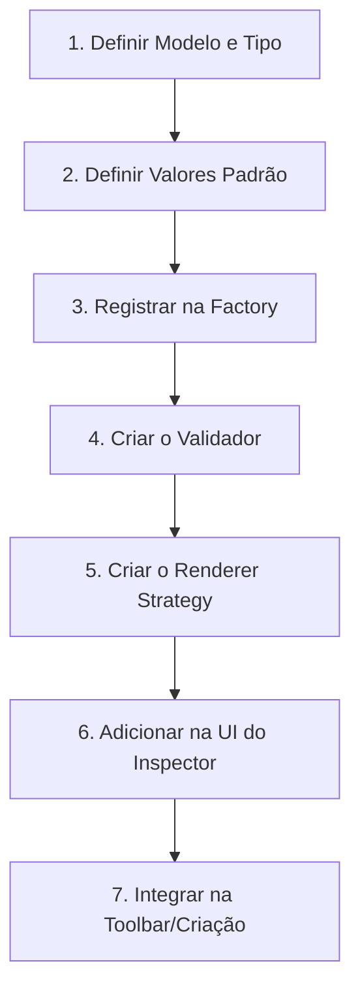

# Guia de Engenharia: Como Adicionar um Novo Elemento

Este guia detalha o passo a passo de como estender o **Label Editor** adicionando um novo elemento gráfico. Como o projeto segue uma arquitetura baseada em dados, orientada a eventos e desacoplada, a adição de um novo tipo exige modificações em pontos específicos bem delimitados.

---

## Fluxo Geral de Adição (Ciclo de Vida)



---

## Passo 1: Definir o Modelo e o Tipo

1. **Defina a string do tipo no Enum:**
   Abra o arquivo [src/domain/models/elements/BaseElement.ts](file:///mnt/h/programação%20-%20copia/projetos/dev/web/label-editor/src/domain/models/elements/BaseElement.ts) e adicione seu novo tipo ao `ElementType`:
   ```typescript
   export enum ElementType {
     // ...
     NOME_DO_ELEMENTO = 'nome_do_elemento'
   }
   ```

2. **Crie a Interface específica:**
   No arquivo [src/domain/models/elements/SpecificElements.ts](file:///mnt/h/programação%20-%20copia/projetos/dev/web/label-editor/src/domain/models/elements/SpecificElements.ts) (ou criando um novo arquivo na pasta se o elemento for complexo), defina a estrutura do seu elemento estendendo `BaseElement`:
   ```typescript
   import { BaseElement, Dimensions } from './BaseElement';

   export interface NomeDoElementoElement extends BaseElement {
     dimensions: Dimensions; // caso possua largura/altura
     propriedadeEspecifica: string;
     outraProp: number;
   }
   ```

3. **Atualize o Union Type global:**
   No arquivo [src/domain/models/Label.ts](file:///mnt/h/programação%20-%20copia/projetos/dev/web/label-editor/src/domain/models/Label.ts), adicione sua nova interface ao union type `AnyElement`:
   ```typescript
   export type AnyElement =
     | TextElement
     | RectangleElement
     | NomeDoElementoElement // Adicionado aqui
     // ...
   ```

---

## Passo 2: Definir os Valores Padrão (Defaults)

Abra o arquivo [src/constants/defaults.ts](file:///mnt/h/programação%20-%20copia/projetos/dev/web/label-editor/src/constants/defaults.ts) e adicione as propriedades padrão de inicialização no objeto `DEFAULTS`:

```typescript
export const DEFAULTS = {
  // ...
  nome_do_elemento: {
    dimensions: { width: 40, height: 20 },
    propriedadeEspecifica: 'valor_padrao',
    outraProp: 10,
    // Note que propriedades comuns (id, type, locked, position) 
    // já são aplicadas automaticamente pela Factory.
  }
}
```

---

## Passo 3: Registrar na Factory de Elementos

Abra o arquivo [src/domain/models/elements/ElementFactory.ts](file:///mnt/h/programação%20-%20copia/projetos/dev/web/label-editor/src/domain/models/elements/ElementFactory.ts). Como a Factory lê os defaults dinamicamente de acordo com o `ElementType`, nenhuma alteração complexa é necessária a menos que você precise de lógica condicional personalizada durante a criação:

```typescript
// Exemplo de condicional opcional dentro do método create()
if (type === ElementType.NOME_DO_ELEMENTO) {
  // Configurações sob demanda
}
```

---

## Passo 4: Criar ou Atualizar as Regras de Validação

Abra o arquivo [src/domain/validators/ElementValidator.ts](file:///mnt/h/programação%20-%20copia/projetos/dev/web/label-editor/src/domain/validators/ElementValidator.ts). Adicione o switch-case para validar a consistência e segurança dos dados do elemento antes da renderização ou exportação:

```typescript
case ElementType.NOME_DO_ELEMENTO:
  const el = element as NomeDoElementoElement;
  if (!el.propriedadeEspecifica) {
    errors.push('A propriedade específica não pode estar vazia.');
  }
  break;
```

---

## Passo 5: Criar o Renderer Strategy (Canvas 2D)

O projeto adota o padrão **Strategy** para desacoplar a renderização.

1. **Crie a classe Renderer:**
   Crie um arquivo na pasta de renderers, por exemplo, `src/domain/services/renderers/NomeDoElementoRenderer.ts`:
   ```typescript
   import { IRenderer } from './IRenderer';
   import { NomeDoElementoElement } from '../../models/elements/SpecificElements';
   import { RenderContext } from './renderer-types';

   export class NomeDoElementoRenderer implements IRenderer {
     public render(element: NomeDoElementoElement, context: RenderContext): void {
       const { ctx, scale, data } = context;
       
       // ElementFactory provê a posição em mm, converta para pixels usando a escala
       const x = element.position.x * scale;
       const y = element.position.y * scale;
       const w = element.dimensions.width * scale;
       const h = element.dimensions.height * scale;

       ctx.save();
       // Implemente a lógica canvas 2d utilizando propriedades do elemento
       ctx.fillStyle = '#000000';
       ctx.fillRect(x, y, w, h);
       ctx.restore();
     }
   }
   ```

2. **Registrar no Orquestrador:**
   Abra o arquivo [src/domain/services/CanvasRenderer.ts](file:///mnt/h/programação%20-%20copia/projetos/dev/web/label-editor/src/domain/services/CanvasRenderer.ts) e adicione o seu novo renderer no mapa interno do construtor:
   ```typescript
   import { NomeDoElementoRenderer } from './renderers/NomeDoElementoRenderer';

   constructor() {
     // ...
     this.renderers.set(ElementType.NOME_DO_ELEMENTO, new NomeDoElementoRenderer());
   }
   ```

---

## Passo 6: Adicionar na UI do Inspector (Propriedades Editáveis)

Para permitir que o usuário configure o elemento pela barra lateral direita (Cockpit / Inspector):

1. **Crie a seção do Inspector:**
   Crie um componente na pasta `src/components/editor/inspector/sections/`, por exemplo: `InspectorSectionNomeDoElemento.ts`. Estenda de uma classe comum de UI ou monte o template de inputs Web Component utilizando a sincronização atômica (`syncValues`):
   ```typescript
   // Exemplo básico estruturado com Shadow DOM
   export class InspectorSectionNomeDoElemento extends HTMLElement {
     // Implemente o renderSkeleton com os campos de controle 
     // como <app-input> ou <ui-number-scrubber>
   }
   ```

2. **Acoplar no ElementInspector:**
   Abra o arquivo [src/components/editor/ElementInspector.ts](file:///mnt/h/programação%20-%20copia/projetos/dev/web/label-editor/src/components/editor/ElementInspector.ts) para importar e exibir sua nova seção dinamicamente com base no elemento atualmente selecionado:
   ```typescript
   // No switch de renderização por tipo de elemento
   case ElementType.NOME_DO_ELEMENTO:
     // Insere o componente <inspector-section-nome-do-elemento> na barra lateral
   ```

---

## Passo 7: Registrar na Toolbar (Botão de Criação)

Abra o arquivo [src/components/editor/Toolbar.ts](file:///mnt/h/programação%20-%20copia/projetos/dev/web/label-editor/src/components/editor/Toolbar.ts) e adicione o botão para inserir o novo elemento no Canvas:

1. **Adicione o botão no HTML:**
   ```html
   <button class="tool-btn" data-action="add-nome-do-elemento" title="Adicionar Nome do Elemento">
     <ui-icon name="custom-icon"></ui-icon>
   </button>
   ```

2. **Vincule o evento de clique:**
   ```typescript
   // Dentro do tratador de cliques de ações:
   if (action === 'add-nome-do-elemento') {
     const newEl = ElementFactory.create(ElementType.NOME_DO_ELEMENTO);
     eventBus.emit('element:create', newEl);
   }
   ```

---

## 💡 Dicas de Sucesso para Dev Solo

- **Atomic Sync:** Evite usar re-render completo por `innerHTML` quando o usuário digita nos inputs do inspector para manter o cursor focado. Atualize apenas o atributo específico do elemento afetado.
- **UnitConverter:** Lembre-se que as coordenadas no banco de dados e arquivos locais salvam em `mm` (milímetros) para compatibilidade de impressão. Use a classe `UnitConverter` para conversões `px` <-> `mm` baseadas no DPI dinâmico.
- **Efeitos de Borda/Rotação:** O `CanvasRenderer` cuida automaticamente de aplicar a rotação de forma universal no centro do elemento. Não tente rotacionar manualmente dentro do seu `NomeDoElementoRenderer` específico, a menos que queira rotacionar partes isoladas dele.
