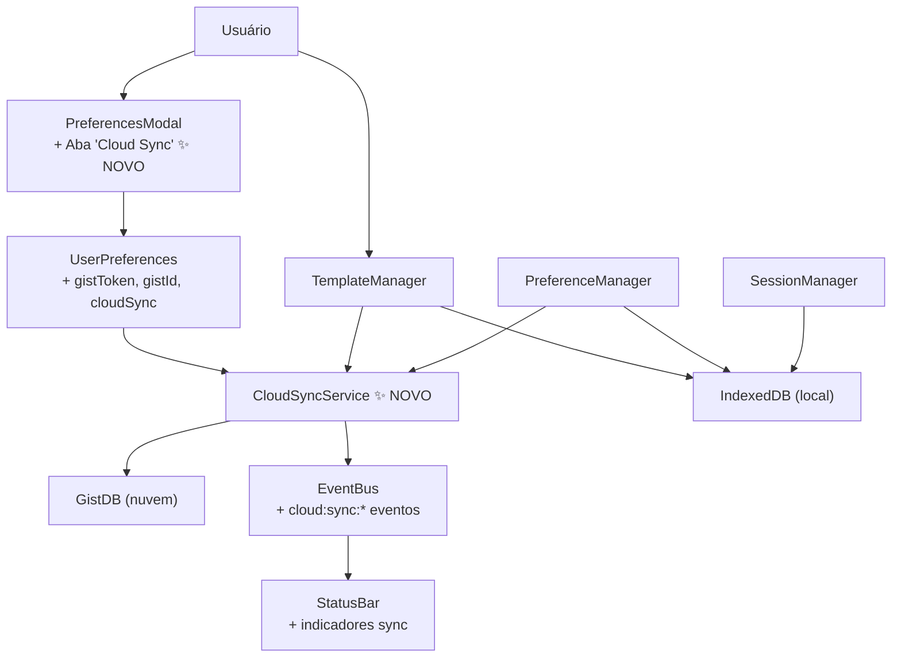

# 🔗 GistDB × Label Editor — Plano de Integração

> **Objetivo:** Adicionar sincronização em nuvem multi-dispositivo ao Label Editor via GistDB, como camada **opcional e não-destrutiva** sobre o IndexedDB existente.
> **Impacto:** Usuários sem configuração do GistDB não percebem nenhuma mudança — o comportamento atual continua idêntico.

---

## 📐 Arquitetura da Integração



---

## 🗂️ Arquivos Afetados / Criados

| Arquivo | Ação | Descrição |
|---------|------|-----------|
| `src/domain/services/CloudSyncService.ts` | **CRIAR** | Orquestrador central da integração GistDB |
| `src/domain/models/UserPreferences.ts` | **EDITAR** | Adicionar campos `gistToken`, `gistId`, `cloudSync`, `cloudSyncInterval` |
| `src/domain/services/PreferenceManager.ts` | **EDITAR** | Persistir `gistToken`/`gistId` no GistDB após configuração |
| `src/domain/services/TemplateManager.ts` | **EDITAR** | Dual-write: salva no IDB + chama `CloudSyncService` |
| `src/domain/services/SessionManager.ts` | **EDITAR** leve | Ignorar `thumbnail` ao sincronizar sessão na nuvem (payload grande) |
| `src/components/preferences/PreferencesModal.ts` | **EDITAR** | Nova aba "☁️ Cloud Sync" com inputs de token, gistId, status |
| `src/core/EventBus.ts` | **EDITAR** | Registrar novos eventos `cloud:*` no `EventMap` |
| `src/components/editor/StatusBar.ts` | **EDITAR** | Indicador visual de status de sync (ícone + tooltip) |
| `package.json` | **EDITAR** | `npm install gistdb` |

---

## 🗓️ Fases de Implementação

---

### Fase 1 — Fundação: `CloudSyncService.ts`
> Criar o orquestrador que abstrai toda a lógica do GistDB do restante do app.

**Localização:** `src/domain/services/CloudSyncService.ts`

#### Responsabilidades

- Criar/reutilizar a instância `GistDB` com base nas `UserPreferences`
- Expor métodos tipados por coleção (`templates`, `preferences`)
- Desabilitar silenciosamente quando não configurado (`gistToken` vazio)
- Emitir eventos `cloud:*` no EventBus para feedback de UI
- Gerenciar inicialização lazy (não bloqueia boot da app)

#### Contrato da Classe

```typescript
// src/domain/services/CloudSyncService.ts

import { GistDB } from 'gistdb';
import { Label } from '../models/Label';
import { UserPreferences } from '../models/UserPreferences';
import eventBus from '../../core/EventBus';
import { logger } from '../../core/Logger';

type SyncStatus = 'idle' | 'syncing' | 'error' | 'offline' | 'unconfigured';

class CloudSyncService {
  #db: GistDB | null = null;
  #status: SyncStatus = 'unconfigured';
  #initPromise: Promise<void> | null = null;

  // Inicializa ou re-inicializa com novas credenciais
  public async configure(token: string, gistId?: string): Promise<void>

  // Retorna true se o GistDB está pronto para uso
  public get isReady(): boolean

  // Templates
  public async pushTemplate(label: Label): Promise<void>
  public async pullTemplates(): Promise<Label[]>
  public async deleteTemplate(id: string): Promise<void>

  // Preferências
  public async pushPreferences(prefs: UserPreferences): Promise<void>
  public async pullPreferences(): Promise<Partial<UserPreferences> | null>

  // Sessão (sem thumbnail para economizar espaço no Gist)
  public async pushSession(label: Label): Promise<void>
  public async pullSession(): Promise<Label | null>

  // Metadados
  public get gistId(): string | null  // Para exibir na UI após criação automática
  public get status(): SyncStatus
  public destroy(): void
}

export const cloudSyncService = new CloudSyncService();
```

#### Lógica de `configure()`

```typescript
public async configure(token: string, gistId?: string): Promise<void> {
  // Destrói instância anterior se existir
  this.#db?.destroy();
  this.#db = null;

  if (!token) {
    this.#status = 'unconfigured';
    eventBus.emit('cloud:status:change', { status: 'unconfigured' });
    return;
  }

  this.#status = 'syncing';
  eventBus.emit('cloud:status:change', { status: 'syncing' });

  try {
    this.#db = await GistDB.create({
      token,
      prefix: 'label-editor',
      gistId: gistId || null,
      ttl: 5 * 60 * 1000,
      conflictResolver: 'last-write-wins',
      autoSync: { onFocus: true, onReconnect: true, onUnload: false },
      deviceName: navigator.platform,
    });

    // Emite gistId para a UI salvar nas preferências (caso foi criado novo Gist)
    eventBus.emit('cloud:configured', { gistId: this.#db.gistId });

    this.#status = 'idle';
    eventBus.emit('cloud:status:change', { status: 'idle' });
    logger.info('CloudSyncService', 'GistDB configured successfully');
  } catch (err) {
    this.#status = 'error';
    eventBus.emit('cloud:status:change', { status: 'error', error: err });
    logger.error('CloudSyncService', 'GistDB configuration failed:', err);
  }
}
```

---

### Fase 2 — Configuração do Usuário

#### 2.1 · `UserPreferences.ts` — Novos campos

Adicionar ao final da interface `UserPreferences` e ao objeto `DEFAULT_PREFERENCES`:

```typescript
// Em UserPreferences (interface)
// --- CLOUD SYNC (GistDB) ---
cloudSync: boolean;          // Habilita/desabilita toda a sync
gistToken: string;           // GitHub PAT (escopo "gist")
gistId: string;              // ID do Gist criado (auto-preenchido)

// Em DEFAULT_PREFERENCES (valores padrão)
cloudSync: false,
gistToken: '',
gistId: '',
```

> [!IMPORTANT]
> O `gistToken` é salvo no `UserPreferences` dentro do **IndexedDB local** — nunca vai para a nuvem. O `CloudSyncService` usa o token apenas em memória via `GistDB` (que usa seu `KeyVault` interno).

#### 2.2 · `PreferencesModal.ts` — Nova aba "Cloud Sync"

Adicionar nova aba `cloud` à sidebar do `PreferencesModal` (junto com as existentes como `general`, `grid`, etc.):

**Conteúdo da aba:**

| Campo | Tipo | Descrição |
|-------|------|-----------|
| Toggle **"Sincronização em nuvem"** | `<app-toggle>` | Habilita/desabilita `cloudSync` |
| Input **"GitHub Token (PAT)"** | `<app-input type="password">` | Campo para o token |
| Input **"Gist ID"** | `<app-input>` | Auto-preenchido; editável para reutilizar Gist existente |
| Botão **"Testar Conexão"** | `<app-button>` | Chama `cloudSyncService.configure()` e mostra resultado |
| Status badge | `<span>` | Mostra `idle` / `syncing` / `error` / `unconfigured` em tempo real |
| Link para criação do token | `<a>` | `https://github.com/settings/tokens` |

**Comportamento ao salvar:**
1. Salva `gistToken`, `gistId`, `cloudSync` no `PreferenceManager` → `IndexedDB`
2. Se `cloudSync === true` e token preenchido → chama `cloudSyncService.configure(token, gistId)`
3. Após `cloud:configured` → salva o novo `gistId` nas preferências (caso Gist foi criado)

---

### Fase 3 — Dual-Write nos Serviços de Domínio

> **Padrão:** Cada serviço continua escrevendo no IndexedDB como antes. A chamada ao `CloudSyncService` é **fire-and-forget** com tratamento de erro isolado — uma falha na nuvem nunca bloqueia a operação local.

#### 3.1 · `TemplateManager.ts` — Dual-write

Modificar `saveCurrentLabel()` e `deleteTemplate()`:

```typescript
// Em saveCurrentLabel(), APÓS o db.put() existente:
if (cloudSyncService.isReady) {
  cloudSyncService.pushTemplate(labelToSave).catch((err) => {
    logger.warn('TemplateManager', 'Cloud sync failed for template:', err);
  });
}

// Em deleteTemplate(), APÓS o db.delete() existente:
if (cloudSyncService.isReady) {
  cloudSyncService.deleteTemplate(id).catch((err) => {
    logger.warn('TemplateManager', 'Cloud delete failed for template:', err);
  });
}
```

Adicionar novo método público `syncFromCloud()` para pull manual:

```typescript
public async syncFromCloud(): Promise<void> {
  if (!cloudSyncService.isReady) return;

  const remoteTemplates = await cloudSyncService.pullTemplates();
  for (const label of remoteTemplates) {
    await db.put(this.STORE_NAME, label); // Merge no IDB local
  }
  eventBus.emit('vault:refreshed', {});
  logger.info('TemplateManager', `Synced ${remoteTemplates.length} templates from cloud`);
}
```

#### 3.2 · `PreferenceManager.ts` — Push de preferências

Modificar `savePreferences()`:

```typescript
// Em savePreferences(), APÓS o db.put() existente:
// Nunca sincronizar o token na nuvem — sanitiza antes do push
const { gistToken, ...prefsToSync } = updated;
if (cloudSyncService.isReady) {
  cloudSyncService.pushPreferences(prefsToSync).catch((err) => {
    logger.warn('PreferenceManager', 'Cloud sync failed for preferences:', err);
  });
}
```

#### 3.3 · `SessionManager.ts` — Push de sessão sem thumbnail

Modificar `saveSession()`:

```typescript
// Em saveSession(), APÓS o db.put() existente:
if (cloudSyncService.isReady) {
  const { thumbnail, ...labelWithoutThumb } = label; // thumbnail é muito grande para Gist
  cloudSyncService.pushSession(labelWithoutThumb).catch((err) => {
    logger.warn('SessionManager', 'Cloud session sync failed:', err);
  });
}
```

---

### Fase 4 — Feedback Visual e Eventos

#### 4.1 · `EventBus.ts` — Novos eventos

Adicionar ao `EventMap`:

```typescript
// Cloud Sync Events
'cloud:status:change': { status: 'idle' | 'syncing' | 'error' | 'offline' | 'unconfigured'; error?: unknown };
'cloud:configured':    { gistId: string };
'cloud:sync:start':    { collection: string };
'cloud:sync:done':     { collection: string; count: number };
'cloud:sync:error':    { collection: string; error: unknown };
'vault:refreshed':     Record<string, never>;  // Força re-render do VaultGallery após pull
```

#### 4.2 · `StatusBar.ts` — Indicador de sync

Adicionar um ícone de nuvem na StatusBar que reage ao `cloud:status:change`:

| Status | Visual |
|--------|--------|
| `unconfigured` | Ícone de nuvem apagado (dim), sem tooltip |
| `idle` | Ícone de nuvem verde `☁️ ✓`, tooltip: "Cloud sync ativo" |
| `syncing` | Ícone de nuvem animado (pulso), tooltip: "Sincronizando..." |
| `error` | Ícone de nuvem vermelho `☁️ ✗`, tooltip: "Erro na sincronização" |
| `offline` | Ícone de nuvem amarelo, tooltip: "Offline — operações em fila" |

#### 4.3 · `main.ts` — Bootstrap do CloudSyncService

Adicionar no bloco `DOMContentLoaded`, após `store.loadPreferences(prefs)`:

```typescript
// Bootstrap do CloudSyncService (Fase 3 — após carregar preferências)
if (prefs.cloudSync && prefs.gistToken) {
  cloudSyncService.configure(prefs.gistToken, prefs.gistId || undefined)
    .then(() => {
      // Salva gistId caso foi gerado automaticamente
      const newGistId = cloudSyncService.gistId;
      if (newGistId && newGistId !== prefs.gistId) {
        preferenceManager.savePreferences({ gistId: newGistId });
      }
    })
    .catch((err) => logger.error('Main', 'Cloud sync bootstrap failed:', err));
}

// Reage a mudanças de configuração de cloud em tempo real
eventBus.on('cloud:configured', ({ gistId }) => {
  preferenceManager.savePreferences({ gistId });
});
```

---

## 📋 Checklist de Implementação

### Fase 1 — `CloudSyncService.ts`
- [ ] `npm install gistdb` no `package.json`
- [ ] Criar `src/domain/services/CloudSyncService.ts`
- [ ] Implementar `configure()` com try/catch e eventos
- [ ] Implementar `pushTemplate()`, `pullTemplates()`, `deleteTemplate()`
- [ ] Implementar `pushPreferences()`, `pullPreferences()`
- [ ] Implementar `pushSession()`, `pullSession()`
- [ ] Getter `isReady`, `gistId`, `status`
- [ ] Implementar `destroy()`

### Fase 2 — Configuração do Usuário
- [ ] Adicionar campos em `UserPreferences` + `DEFAULT_PREFERENCES`
- [ ] Criar HTML/CSS da aba "Cloud Sync" no `PreferencesModal`
- [ ] Implementar lógica de save/test-connection na aba
- [ ] Listener `cloud:status:change` para atualizar badge de status na aba

### Fase 3 — Dual-Write
- [ ] `TemplateManager.saveCurrentLabel()` — push para nuvem
- [ ] `TemplateManager.deleteTemplate()` — delete na nuvem
- [ ] `TemplateManager.syncFromCloud()` — método de pull manual
- [ ] `PreferenceManager.savePreferences()` — push (sem token)
- [ ] `SessionManager.saveSession()` — push (sem thumbnail)

### Fase 4 — Feedback Visual
- [ ] Registrar novos eventos `cloud:*` no `EventBus.ts`
- [ ] Indicador de sync na `StatusBar.ts`
- [ ] Bootstrap em `main.ts` com `cloudSyncService.configure()`
- [ ] Listener `cloud:configured` para persistir `gistId` automático

---

## ⚠️ Decisões de Design

> [!IMPORTANT]
> **Isolamento total de falha:** Toda chamada ao `cloudSyncService` usa `.catch()` separado. Uma falha de rede, token inválido ou rate limit do GitHub **nunca** propaga para a operação local no IndexedDB.

> [!NOTE]
> **Token nunca vai para a nuvem:** Em `PreferenceManager.savePreferences()`, o campo `gistToken` é explicitamente removido antes do push para o GistDB. O token fica apenas no IndexedDB local.

> [!TIP]
> **Pull manual vs. AutoSync:** A sincronização ativa (`pullTemplates()`) deve ser **acionada pelo usuário** (ex: botão "Sincronizar do servidor" no Vault). O GistDB já gerencia autoSync passivo (`onFocus`, `onReconnect`) para escritas. Evitar polling automático de pull para não consumir cota da API do GitHub.

> [!WARNING]
> **`thumbnail` é base64 pesado:** O campo `thumbnail` de um `Label` pode ter dezenas de KB. Nunca incluí-lo no push para o GistDB — filtrá-lo sempre antes de qualquer operação de sync na nuvem.
